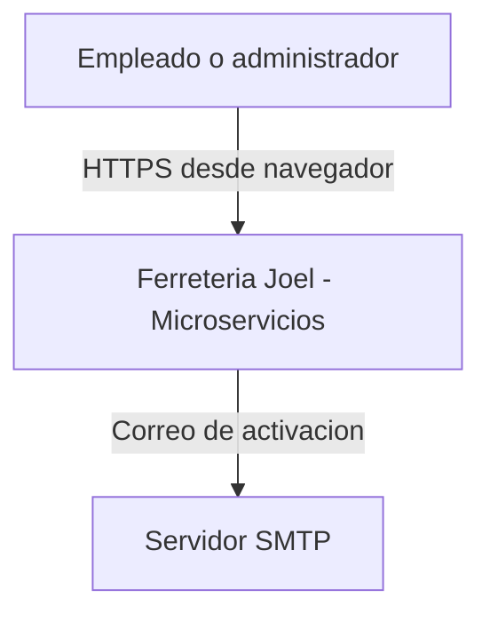
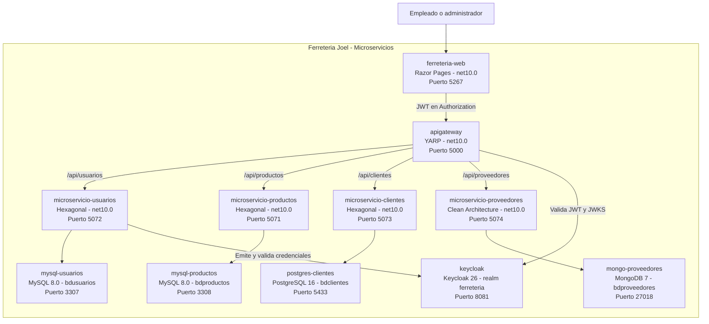
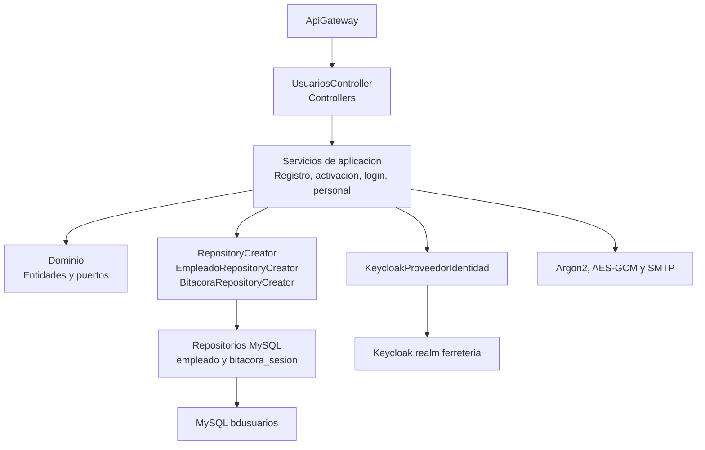
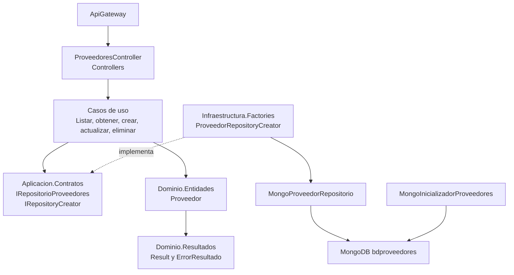
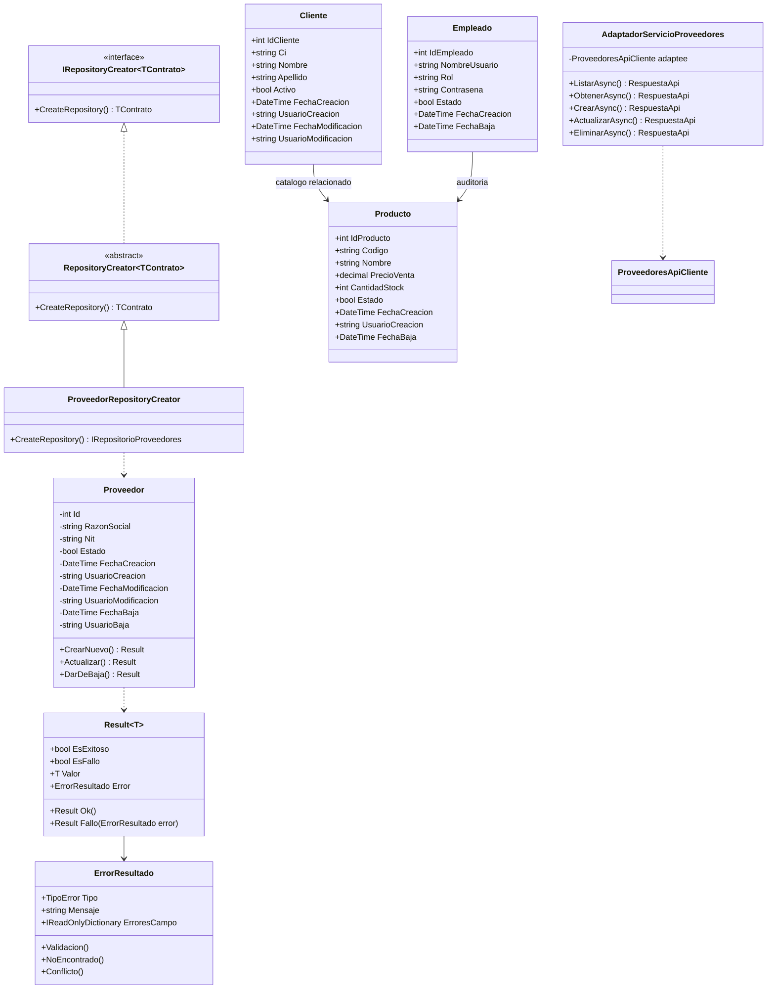
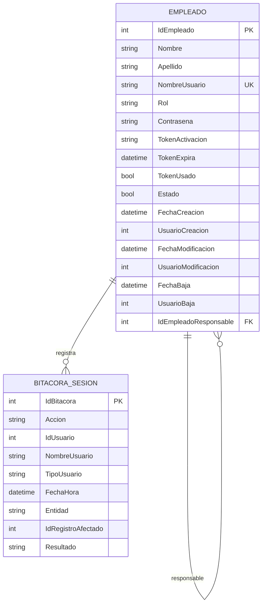
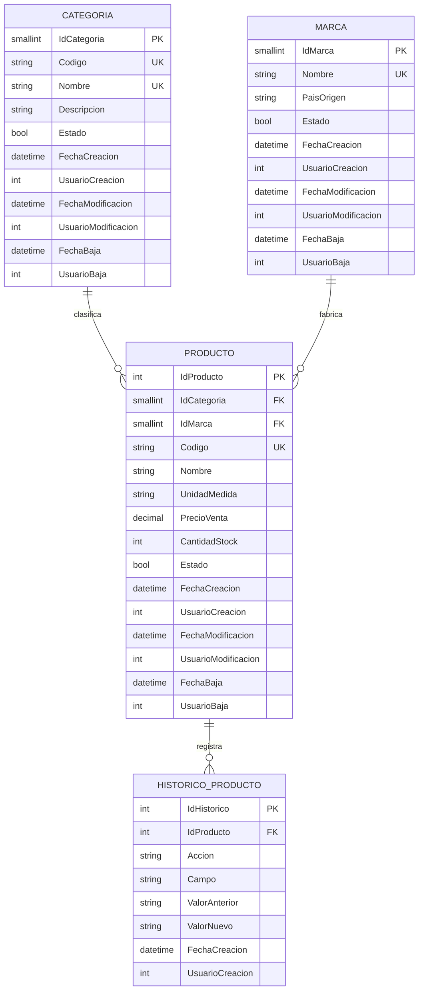
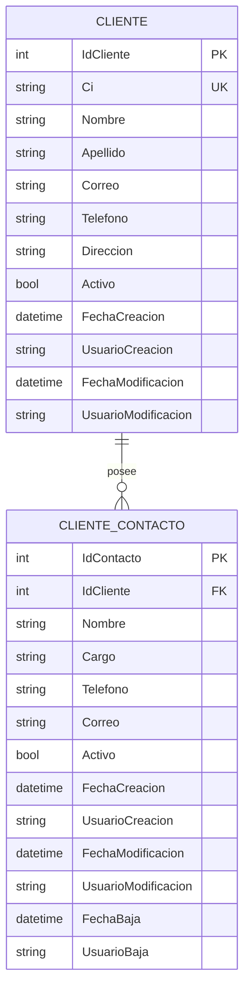
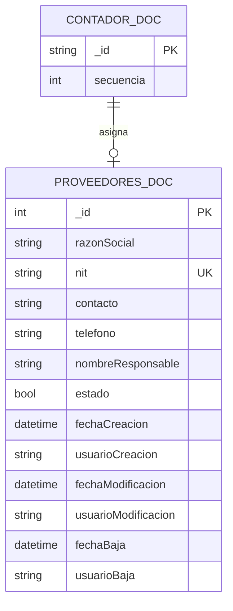
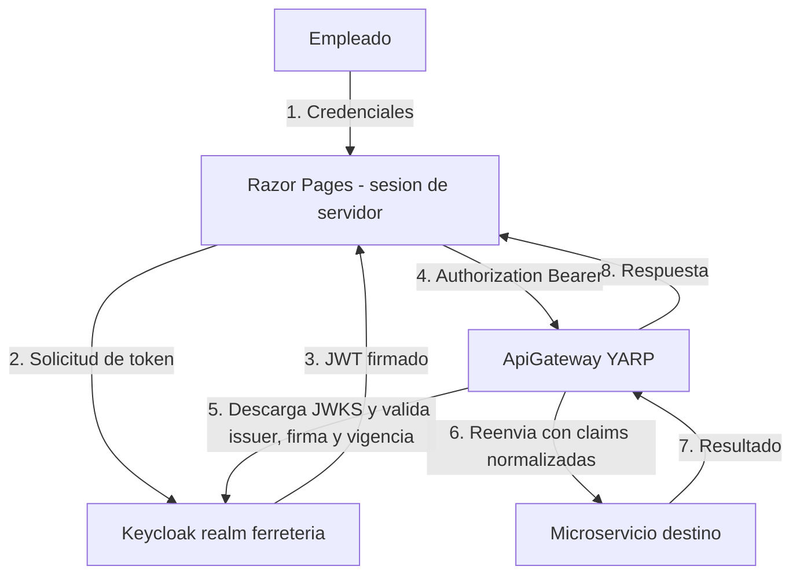

# Ferretería Joel — Microservicios

## Documento del ANEXO 1 — 3EC Entregable Único

**Asignatura:** Arquitectura de software  
**Competencia:** 3EC — Implementación de soluciones de software aplicando estilos de arquitectura y patrones de diseño  
**Entregable:** Entregable Único — Microservicios  
**Proyecto:** Ferretería Joel — Microservicios  
**Integrantes:** _[completar con nombres y códigos de los integrantes]_  
**Repositorio:** https://github.com/Macacofig/Ferreteria_Joel_MicroServicios  
**Fecha:** 24/11/2026

---

## 1. Introducción

El presente documento describe la solución de software implementada para Ferretería Joel bajo un estilo de **microservicios**, con una interfaz web Razor Pages, una puerta de entrada basada en YARP y cuatro servicios autónomos con persistencia propia. Cada microservicio posee su propio motor de base de datos, su modelo de dominio, sus contratos de aplicación y su infraestructura, de modo que el cambio en uno no obliga a modificar los demás.

La solución se ejecuta como un conjunto de **11 contenedores Docker** orquestados mediante `docker-compose.yml`: cuatro microservicios, cuatro motores de datos, Keycloak, el API Gateway y la aplicación web. La comunicación entre la interfaz y los servicios se realiza exclusivamente a través del gateway, que valida los tokens JWT antes de reenviar cada petición.

El documento está organizado de acuerdo con la estructura solicitada para el ANEXO 1. Se presentan el marco teórico, la descripción funcional, los diagramas C4 en notación Mermaid en tres niveles, los diagramas de clases y de datos, evidencias de código de los patrones y estilos aplicados, la configuración de resiliencia y seguridad, la organización del repositorio y las conclusiones del trabajo.

### 1.1 Propósito del documento

- Documentar la arquitectura implementada y su trazabilidad con los requisitos.
- Evidenciar la aplicación de estilos arquitectónicos y patrones de diseño en código real.
- Servir de guía técnica para la ejecución, defensa y mantenimiento del entregable.
- Consolidar la configuración de red, puertos, identidad, resiliencia y persistencia en una sola referencia.

### 1.2 Alcance

El alcance cubre los componentes desplegados en el entorno Docker y el frontend que los consume. No se describe el monolito previo, dado que este entregable corresponde a la versión migrada a microservicios.

---

## 2. Marco Teórico

### 2.1 Arquitectura de microservicios

La arquitectura de microservicios descompone un sistema en servicios pequeños, independientes y desplegables por separado, cada uno con una responsabilidad de negocio delimitada y una base de datos propia. Entre sus características relevantes para el proyecto se encuentran:

| Característica | Aplicación en Ferretería Joel |
|---|---|
| Autonomía de despliegue | Cada microservicio tiene su propio `Dockerfile` y su contenedor. |
| Persistencia por servicio | MySQL para usuarios y productos, PostgreSQL para clientes y MongoDB para proveedores. |
| Comunicación indirecta | La web llama al API Gateway, nunca directamente a los microservicios. |
| centralización de acceso | YARP aplica autenticación y enrutamiento antes del reenvío. |
| Resiliencia | Reintentos acotados, timeouts por intento y timeouts totales. |
| Identidad federada | Keycloak emite y firma los JWT validados por el gateway y los servicios. |

### 2.2 Estilos arquitectónicos

#### 2.2.1 Arquitectura hexagonal

La arquitectura hexagonal, también denominada *ports and adapters*, sitúa la lógica de negocio en el centro y define puertos —interfaces— mediante los cuales el dominio se comunica con el exterior. Los adaptadores de infraestructura implementan esos puertos y son inyectados desde la configuración de la aplicación.

En **Usuarios**, **Productos** y **Clientes** el dominio expone contratos como `IRepositoryProducto`, `IClienteRepositorio` o `IRepositoryEmpleado`; la capa de infraestructura proporciona implementaciones MySQL o PostgreSQL y los servicios de aplicación solo conocen los contratos. La dirección de la dependencia apunta hacia el dominio.

#### 2.2.2 Clean Architecture

La arquitectura limpia organiza el código en capas concéntricas: entidades, casos de uso, interfaces de aplicación e infraestructura. La regla de dependencia exige que las capas internas no conozcan a las externas.

**MicroServicioProveedores** materializa este estilo con las carpetas `Dominio`, `Aplicacion`, `Infraestructura`, `Comun` y `Controllers`. En `Aplicacion.Contratos` se declara `IRepositoryCreator<TContrato>`, mientras que `Infraestructura.Factories` contiene `ProveedorRepositoryCreator`, que devuelve `MongoProveedorRepositorio`. El dominio permanece independiente del driver de MongoDB.

#### 2.2.3 API Gateway

El patrón API Gateway concentra en un único punto las responsabilidades transversales: enrutamiento, validación del token, normalización de *claims* de roles, timeouts y reintentos. YARP —*Yet Another Reverse Proxy*— se configura de forma declarativa en `appsettings.json`.

### 2.3 Patrones de diseño aplicados

| Patrón | Clasificación | Evidencia en la solución |
|---|---|---|
| Adapter | Estructural | `AdaptadorServicioUsuarios`, `AdaptadorServicioProductos`, `AdaptadorServicioClientes` y `AdaptadorServicioProveedores` adaptan clientes HTTP al contrato consumido por las Razor Pages. |
| Result | Transaccional y de dominio | `Result`, `Result<T>` y `ErrorResultado` transportan éxito, error, tipo de error y errores por campo sin lanzar excepciones para reglas de negocio. |
| Factory Method | Creacional | `RepositoryCreator<T>` y sus creadores concretos, incluidos `ProductoRepositoryCreator`, `CatalogoAuxiliarRepositoryCreator`, `HistoricoProductoRepositoryCreator` y `ProveedorRepositoryCreator`. |
| Repository | Persistencia | Repositorios MySQL, PostgreSQL y MongoDB encapsulan el acceso a datos tras contratos del dominio. |
| Facade | Estructural | El gateway actúa como fachada del sistema; los adaptadores también simplifican la interfaz de los clientes HTTP para la capa de presentación. |
| Unit of Work | Persistencia | La coordinación de lecturas y escrituras relacionadas se concentra en los servicios de aplicación y repositorios, manteniendo una unidad lógica de trabajo por caso de uso. |
| Strategy implícito | Comportamental | La implementación concreta de persistencia y las reglas de autorización por rol se seleccionan en tiempo de ejecución mediante inyección de dependencias y políticas. |

Complementariamente, el frontend aplica el **principio de segregación de interfaces (ISP)**: el contrato único `IServicioProductos` se compone de `IProductosConsulta`, `IProductosComandos`, `ICatalogoConsulta` e `ICatalogoComandos`, y cada Razor Page recibe solo las operaciones que utiliza.

#### 2.3.1 Adapter

El adaptador envuelve al *adaptee* —el cliente HTTP— y expone el contrato esperado por la interfaz de usuario. De este modo, las páginas no conocen rutas, encabezados ni formatos crudos de la API.

#### 2.3.2 Result

El tipo `Result<T>` evita usar excepciones para flujos esperados de validación. Expone `EsExitoso`, `EsFallo` y `Valor`, con factorías `Ok`, `Fallo`, `Ok<T>` y `Fallo<T>`. En Proveedores, `ErrorResultado` adopta además un `TipoError` —`Validacion`, `NoEncontrado`, `Conflicto` o `NoAutorizado`— y errores por campo para que el adaptador HTTP elija el código de respuesta adecuado. En Productos, `ValorRequerido` garantiza el valor cuando el resultado es exitoso.

#### 2.3.3 Factory Method

El creador abstracto declara `CreateRepository()`. Cada creador concreto decide qué repositorio instanciar; las capas superiores dependen solo del contrato devuelto, no de la clase concreta.

#### 2.3.4 Repository

El repositorio medianiza entre el dominio y el motor de datos. Aísla sentencias SQL o consultas Mongo y expone operaciones semanticamente vinculadas al agregado.

### 2.4 Lenguajes y tecnologías

| Tecnología | Versión o detalle | Uso principal |
|---|---|---|
| C# | .NET 10 | Implementación de microservicios, gateway y frontend. |
| Docker / Docker Compose | Imágenes y orquestación local | 11 contenedores en la red `ferreteria-net`. |
| YARP | Integrado en .NET 10 | Proxy inverso y enrutamiento de cuatro rutas `/api/**`. |
| Keycloak | 26.0 | Realm `ferreteria`, emisión y validación de JWT, roles. |
| MySQL | 8.0 | Bases `bdusuarios` y `bdproductos`. |
| PostgreSQL | 16 | Base `bdclientes`. |
| MongoDB | 7 | Base documental `bdproveedores`. |
| Razor Pages | ASP.NET Core | Interfaz web con sesión de servidor y adaptadores. |
| Polly / Microsoft.Extensions.Http.Resilience | Pipelines de resiliencia | Reintentos y timeouts en el gateway. |
| Argon2 | Hash de contraseña | Respaldo local de credenciales en usuarios. |
| AES-GCM | Cifrado autenticado | Protección del enlace de activación de cuentas. |
| SMTP | Envío de correo | Notificación del enlace de activación. |
| Mermaid | Notación de diagramas | Diagramas C4, clases y entidades de este documento. |

---

## 3. Descripción del proyecto

### 3.1 Contexto y problemática

Ferretería Joel necesita gestionar el acceso del personal, el catálogo de productos, la información de clientes y el registro de proveedores. La solución anterior concentraba estas responsabilidades en una aplicación única, lo que dificultaba la evolución independiente de cada área, la elección de motores de datos especializados y la aplicación homogénea de políticas de seguridad.

La migración a microservicios permite separar responsabilidades, escalar componentes de forma autónoma y aplicar estilos arquitectónicos distintos según la naturaleza de cada dominio, sin perder una experiencia de usuario única gracias al gateway y al frontend Razor.

### 3.2 Requisitos funcionales mínimos

| ID | Requisito | Servicio responsable |
|---|---|---|
| RF-01 | Registrar empleados y activar cuentas mediante un enlace cifrado enviado por correo. | MicroServicioUsuarios |
| RF-02 | Autenticar al personal y registrar la bitácora de inicio y cierre de sesión. | MicroServicioUsuarios, Keycloak |
| RF-03 | Administrar productos, categorías, marcas e histórico de cambios. | MicroServicioProductos |
| RF-04 | Registrar, consultar, editar y dar de baja clientes y sus contactos. | MicroServicioClientes |
| RF-05 | Registrar, consultar, editar, dar de baja y reactivar proveedores. | MicroServicioProveedores |
| RF-06 | Consumir los cuatro servicios desde una interfaz web única con sesión de servidor. | FERRETERIA_JOEL_Web |
| RF-07 | Exigir JWT válido en todas las rutas `/api/**` y mantener públicos `/health` y `/index`. | ApiGateway |
| RF-08 | Conservar auditoría de creación, modificación y baja lógica en las entidades principales. | Los cuatro microservicios |

### 3.3 Inventario de contenedores

| # | Contenedor | Tecnología | Base o función | Puerto host |
|---|---|---|---|---|
| 1 | `microservicio-usuarios` | .NET 10 | API hexagonal de usuarios | 5072 |
| 2 | `mysql-usuarios` | MySQL 8.0 | `bdusuarios` | 3307 |
| 3 | `keycloak` | Keycloak 26 | Realm `ferreteria`, JWT y JWKS | 8081 |
| 4 | `microservicio-productos` | .NET 10 | API hexagonal de productos | 5071 |
| 5 | `mysql-productos` | MySQL 8.0 | `bdproductos` | 3308 |
| 6 | `microservicio-clientes` | .NET 10 | API hexagonal de clientes | 5073 |
| 7 | `postgres-clientes` | PostgreSQL 16 | `bdclientes` | 5433 |
| 8 | `microservicio-proveedores` | .NET 10 | API Clean Architecture | 5074 |
| 9 | `mongo-proveedores` | MongoDB 7 | `bdproveedores` | 27018 |
| 10 | `apigateway` | .NET 10 + YARP | Enrutamiento, JWT y resiliencia | 5000 |
| 11 | `ferreteria-web` | Razor Pages | Interfaz de usuario | 5267 |

### 3.4 Puertos expuestos por los microservicios

Cada microservicio expone su API REST y un endpoint `/index` navegable, además de `/health` para las sondas de Docker. El gateway expone sus propios `/health` e `/index` como endpoints públicos, y mapea `/` como redirección a `/index`.

---

## 4. Diseño e implementación

### 4.1 Diagrama C4 Nivel 1 — contexto del sistema

El siguiente diagrama muestra el sistema en su conjunto y los actores que interactúan con él.



### 4.2 Diagrama C4 Nivel 2 — contenedores

Se representan los 11 contenedores definidos en `docker-compose.yml`, sus tecnologías y las dependencias principales.



### 4.3 Diagrama C4 Nivel 3 — componentes

#### 4.3.1 Componentes de MicroServicioUsuarios



#### 4.3.2 Componentes de MicroServicioProveedores



### 4.4 Combinación de niveles 1-2-3

Los tres niveles se complementan mediante un zoom progresivo. El **nivel 1** sitúa a Ferretería Joel como un único sistema que atiende al personal y envía correos de activación. El **nivel 2** abre ese sistema y muestra los 11 contenedores, la red Docker, los motores de datos y el gateway. El **nivel 3** detalla el interior de los contenedores de negocio: controladores, casos de uso o servicios, puertos, creadores, repositorios y componentes de seguridad.

La lectura combinada permite seguir una petición desde el navegador, pasando por el adaptador web y el gateway, hasta el repositorio concreto y su base de datos, y verificar en cada salto qué estilo y qué patrón gobiernan la comunicación.

### 4.5 Diagramas de clases

El siguiente diagrama representa los tipos transversales `Result<T>`, `IRepositoryCreator<T>`, los adaptadores web y las entidades con auditoría.



### 4.6 Capturas de aplicación de patrones

A continuación se presentan fragmentos de código reales del repositorio. Se denominan “capturas” a los bloques de código con su ruta de archivo, sin emplear imágenes de pantalla.

#### Captura 1: Adapter en `FERRETERIA_JOEL_Web/Servicios/AdaptadorServicioProveedores.cs`

```csharp
public class AdaptadorServicioProveedores : IServicioProveedores
{
    private readonly ProveedoresApiCliente _adaptee;

    public AdaptadorServicioProveedores(ProveedoresApiCliente adaptee)
    {
        _adaptee = adaptee;
    }

    public async Task<RespuestaApi<List<ProveedorDto>>> ListarAsync(
        string? token, string? orden = null, CancellationToken ct = default)
    {
        var respuesta = await _adaptee.ListarAsync(token, orden, ct);
        return Traducir(respuesta, "No se pudo obtener el listado de proveedores.");
    }

    private static RespuestaApi<T> Traducir<T>(
        RespuestaApi<T> respuesta, string mensajePorDefecto)
    {
        if (respuesta.Exitoso)
        {
            return respuesta;
        }

        if (string.IsNullOrWhiteSpace(respuesta.Mensaje))
        {
            respuesta.Mensaje = respuesta.Errores.FirstOrDefault() ?? mensajePorDefecto;
        }

        return respuesta;
    }
}
```

#### Captura 2: Result en `MicroServicioProveedores/Dominio/Resultados/Result.cs`

```csharp
public class Result
{
    public bool EsExitoso { get; }
    public bool EsFallo => !EsExitoso;
    public ErrorResultado? Error { get; }

    protected Result(bool esExitoso, ErrorResultado? error)
    {
        EsExitoso = esExitoso;
        Error = error;
    }

    public static Result Ok() => new(true, null);
    public static Result Fallo(ErrorResultado error) => new(false, error);

    public static Result<T> Ok<T>(T valor) => new(valor, true, null);
    public static Result<T> Fallo<T>(ErrorResultado error) => new(default, false, error);
}

public sealed class Result<T> : Result
{
    public T? Valor { get; }

    internal Result(T? valor, bool esExitoso, ErrorResultado? error)
        : base(esExitoso, error)
    {
        Valor = valor;
    }
}
```

#### Captura 3: Factory Method en `MicroServicioProductos/Infraestructura/Factories/RepositoryCreator.cs`

```csharp
public abstract class RepositoryCreator<TRepository>
{
    public abstract TRepository CreateRepository();
}

public sealed class ProductoRepositoryCreator : RepositoryCreator<IRepositoryProducto>
{
    private readonly IDbConnectionFactory _connectionFactory;

    public ProductoRepositoryCreator(IDbConnectionFactory connectionFactory)
    {
        _connectionFactory = connectionFactory;
    }

    public override IRepositoryProducto CreateRepository() =>
        new MySqlProductoRepository(_connectionFactory);
}

public sealed class CatalogoAuxiliarRepositoryCreator
    : RepositoryCreator<IRepositoryCatalogoAuxiliar>
{
    public override IRepositoryCatalogoAuxiliar CreateRepository() =>
        new MySqlCatalogoAuxiliarRepository(_connectionFactory);
}

public sealed class HistoricoProductoRepositoryCreator
    : RepositoryCreator<IRepositoryHistoricoProducto>
{
    public override IRepositoryHistoricoProducto CreateRepository() =>
        new MySqlHistoricoProductoRepository(_connectionFactory);
}
```

#### Captura 4: Factory Method en `MicroServicioProveedores/Infraestructura/Factories/ProveedorRepositoryCreator.cs`

```csharp
public sealed class ProveedorRepositoryCreator : RepositoryCreator<IRepositorioProveedores>
{
    private readonly IMongoDatabase _database;

    public ProveedorRepositoryCreator(IMongoDatabase database)
    {
        _database = database;
    }

    public override IRepositorioProveedores CreateRepository()
        => new MongoProveedorRepositorio(_database);
}
```

#### Captura 5: Configuración de rutas en `ApiGateway/appsettings.json`

Las rutas `usuarios`, `productos`, `clientes` y `proveedores` exigen la política `Default`, por lo que toda petición `/api/**` debe presentar un JWT válido. Las únicas excepciones son `usuarios-login`, `usuarios-activar` y `usuarios-activar-validar`: llevan `Order: -1` y no declaran `AuthorizationPolicy` para que el navegador pueda obtener el token y activar cuentas antes de tener sesión. El orden negativo es necesario porque YARP evalúa primero la ruta más específica; si no, la ruta comodín `/api/usuarios/{**catch-all}` con JWT capturaría también el login.

```json
{
  "ReverseProxy": {
    "Routes": {
      "usuarios-login": {
        "ClusterId": "usuarios",
        "Order": -1,
        "Match": { "Path": "/api/usuarios/login" }
      },
      "usuarios-activar": {
        "ClusterId": "usuarios",
        "Order": -1,
        "Match": { "Path": "/api/usuarios/activar" }
      },
      "usuarios-activar-validar": {
        "ClusterId": "usuarios",
        "Order": -1,
        "Match": { "Path": "/api/usuarios/activar/validar" }
      },
      "usuarios": {
        "ClusterId": "usuarios",
        "AuthorizationPolicy": "Default",
        "Match": { "Path": "/api/usuarios/{**catch-all}" }
      },
      "productos": {
        "ClusterId": "productos",
        "AuthorizationPolicy": "Default",
        "Match": { "Path": "/api/productos/{**catch-all}" }
      },
      "clientes": {
        "ClusterId": "clientes",
        "AuthorizationPolicy": "Default",
        "Match": { "Path": "/api/clientes/{**catch-all}" }
      },
      "proveedores": {
        "ClusterId": "proveedores",
        "AuthorizationPolicy": "Default",
        "Match": { "Path": "/api/proveedores/{**catch-all}" }
      }
    },
    "Clusters": {
      "usuarios": {
        "Destinations": {
          "principal": { "Address": "http://microservicio-usuarios:8080/" }
        }
      }
    }
  }
}
```

Los endpoints `/health` e `/index` del propio gateway quedan públicos para los chequeos de contenedor; el resto de rutas `/api/**` —incluidas las de usuarios distintas de login/activación— exige JWT. El frontend guarda el token en la sesión de servidor y lo adjunta como `Authorization: Bearer <token>` en cada petición.

### 4.7 Capturas de aplicación de estilos arquitectónicos

#### 4.7.1 Estructura de carpetas por capas

La organización física de los microservicios refleja la separación entre dominio, aplicación e infraestructura:

```text
MicroServicioUsuarios/
├── Dominio/
│   ├── Entidades/
│   ├── Puertos/
│   └── Utilidades/
├── Aplicacion/
│   └── Servicios/
├── Infraestructura/
│   ├── Conexion/
│   ├── Factories/
│   ├── Repositorios/
│   └── Seguridad/
├── Controllers/
└── Program.cs

MicroServicioProductos/
├── Dominio/Entidades
├── Dominio/Puertos
├── Dominio/Resultados
├── Aplicacion/Modelos
├── Aplicacion/Servicios
└── Infraestructura/Conexion, Factories, Repositorios

MicroServicioClientes/
├── Dominio/Entidades
├── Dominio/Puertos
├── Dominio/Comunes
├── Aplicacion/Modelos, Puertos, Servicios, Validaciones
└── Infraestructura/Conexion, Factories, Persistencia, Repositorios, Seguridad

MicroServicioProveedores/
├── Dominio/Entidades
├── Dominio/Resultados
├── Aplicacion/CasosDeUso
├── Aplicacion/Contratos
├── Aplicacion/Modelos
├── Comun
├── Infraestructura/Factories
├── Infraestructura/Persistencia
├── Controllers
└── Program.cs
```

#### Captura 6: Inversión de dependencias en `MicroServicioUsuarios/Program.cs`

```csharp
builder.Services.AddSingleton<IDbConnectionFactory, MySqlConnectionFactory>();

// Los servicios reciben creadores y piden el repositorio concreto a traves
// del contrato del dominio; nunca conocen las clases MySql*.
builder.Services.AddScoped<RepositoryCreator<IRepositoryEmpleado>,
    EmpleadoRepositoryCreator>();
builder.Services.AddScoped<RepositoryCreator<IRepositoryBitacora>,
    BitacoraRepositoryCreator>();

builder.Services.AddHttpClient<IProveedorIdentidad,
    KeycloakProveedorIdentidad>();

builder.Services.AddSingleton<IHasheadorContrasena,
    Argon2HasheadorContrasena>();
builder.Services.AddScoped<IEnviadorCorreo, SmtpEnviadorCorreo>();
builder.Services.AddScoped<IConstructorEnlaceActivacion,
    ConstructorEnlaceActivacionApi>();
builder.Services.AddScoped<IContextoUsuario, ContextoUsuarioJwt>();
```

#### Captura 7: Inversión de dependencias en `MicroServicioProveedores/Program.cs`

```csharp
builder.Services.AddSingleton<IMongoClient>(_ => new MongoClient(cadenaMongo));
builder.Services.AddSingleton(sp =>
    sp.GetRequiredService<IMongoClient>().GetDatabase(nombreBd));
// Factory Method: Aplicacion solo conoce IRepositoryCreator<T>; el creador
// concreto es el unico que referencia al repositorio Mongo.
builder.Services.AddScoped<IRepositoryCreator<IRepositorioProveedores>,
    ProveedorRepositoryCreator>();
builder.Services.AddScoped<MongoInicializadorProveedores>();

builder.Services.AddScoped<ListarProveedoresCasoDeUso>();
builder.Services.AddScoped<ObtenerProveedorCasoDeUso>();
builder.Services.AddScoped<CrearProveedorCasoDeUso>();
builder.Services.AddScoped<ActualizarProveedorCasoDeUso>();
builder.Services.AddScoped<EliminarProveedorCasoDeUso>();
```

### 4.8 Diagramas de bases de datos

Cada microservicio gestiona su propia base de datos. No existen claves foráneas entre bases de servicios distintos; la auditoría almacena los identificadores de usuario como valores de texto o entero, según el motor.

#### 4.8.1 MySQL de usuarios — `bdusuarios`



#### 4.8.2 MySQL de productos — `bdproductos`



#### 4.8.3 PostgreSQL de clientes — `bdclientes`



La tabla `cliente_contacto` completa el modelo de clientes con contactos por cliente, baja lógica y auditoría de creación, modificación y baja.

#### 4.8.4 Esquema documental de MongoDB — `bdproveedores`



La colección `proveedores` conserva la auditoría completa del documento y la baja lógica mediante `estado`, `fechaBaja` y `usuarioBaja`. La colección de contador mantiene la secuencia numérica del identificador entero.

### 4.9 Resiliencia y seguridad

#### 4.9.1 Resiliencia del gateway

Los pipelines se implementan en `ApiGateway/Infraestructura/ResilienciaHttp.cs` y se inyectan en los canales salientes. YARP envuelve su handler con `ResilienciaForwarderHttpClientFactory`, y el backchannel de JWT usa `ResilienceHandler` sobre el pipeline de Keycloak.

| Canal | Reintentos | Retroceso | Jitter | Timeout por intento | Timeout total |
|---|---:|---|---|---:|---:|
| YARP hacia microservicios | 2 | Lineal, 200 ms | Sí | 5 s | 12 s |
| Backchannel de Keycloak | 2 | Lineal, 200 ms | Sí | 3 s | 6 s |
| Configuración de validación JWT | — | — | — | `BackchannelTimeout = 8 s` | — |

Los reintentos se desactivan para métodos HTTP no seguros, de modo que altas, ediciones y bajas no se dupliquen ante una respuesta ambigua.

#### 4.9.2 Flujo JWT



El gateway normaliza los roles de `realm_access.roles` a `ClaimTypes.Role` y el nombre de usuario a `ClaimTypes.Name`. La web conserva el JWT en la sesión de servidor y lo adjunta en el encabezado `Authorization` de cada llamada realizada por los adaptadores.

#### 4.9.3 Seguridad adicional

- **Argon2:** se conserva un hash de credencial como respaldo local en `empleado`.
- **AES-GCM:** el enlace de activación se cifra con una clave compartida entre la web y el microservicio de usuarios.
- **Baja lógica:** las entidades principales conservan `Estado`, `FechaBaja` y `UsuarioBaja`.
- **Auditoría:** cada tabla o documento registra usuario y fecha de creación y modificación.
- **Configuración sensible:** contraseñas, claves y parámetros SMTP se leen desde variables de entorno y `.env`, que no se versiona.

---

## 5. Repositorio de control de versiones

**URL:** https://github.com/Macacofig/Ferreteria_Joel_MicroServicios

### 5.1 Organización de ramas

| Rama | Propósito |
|---|---|
| `main` | Rama principal con la versión integrada y estable del sistema de microservicios. |
| `feature/proveedores-adrian` | Desarrollo del microservicio de proveedores, Clean Architecture, MongoDB y Factory Method. |
| `valeria/microservicio-clientes` | Desarrollo del microservicio de clientes, PostgreSQL y modelo de contactos. |
| `griz/microservicio-productos` | Desarrollo del microservicio de productos, MySQL, catálogo e histórico. |

### 5.2 Convención de commits

| Prefijo | Uso | Ejemplo |
|---|---|---|
| `feat` | Nueva funcionalidad | `feat(proveedores): auditoría y baja lógica` |
| `fix` | Corrección de defectos | `fix(clientes): normalizar correo duplicado` |
| `refactor` | Mejora estructural sin cambiar comportamiento | `refactor(clientes): Factory Method y organización de infraestructura` |
| `docs` | Documentación | `docs: corregir puesta en marcha y aclarar creación del .env desde .env.example` |

### 5.3 Configuración y secretos

El archivo `.env.example` documenta las variables requeridas. El archivo `.env` real se mantiene fuera del control de versiones mediante `.gitignore`. Las credenciales de MySQL, PostgreSQL, Keycloak, la clave de protección de URLs y los parámetros SMTP se inyectan como variables de entorno en los contenedores.

---

## 6. Conclusiones

### 6.1 Aprendizajes sobre microservicios

La implementación permitió comprender la autonomía de cada servicio en términos de código, despliegue y persistencia. La elección de un motor de datos distinto por dominio mostró que la arquitectura puede adaptarse a la naturaleza de cada problema: tablas relacionales para usuarios, productos y clientes, y documentos para proveedores. El gateway simplificó la experiencia del cliente web y concentró las políticas transversales sin acoplar a los servicios entre sí.

### 6.2 Aprendizajes sobre patrones y arquitectura

La arquitectura hexagonal y la Clean Architecture hicieron explícita la inversión de dependencias: el dominio define contratos y la infraestructura los implementa. El patrón Result mejoró el manejo de errores de negocio al sustituir excepciones por valores ricos en información. Factory Method mantuvo desacoplados los casos de uso de las clases concretas de repositorio, y Adapter aisló a las Razor Pages de los detalles HTTP del gateway.

### 6.3 Dificultades abordadas

Se trabajó en la coordinación de arranques mediante healthchecks y `depends_on`, en la validación de un mismo token con distintos emisores —interno de Docker y público— y en la limitación de reintentos para no duplicar escrituras. También se administró la auditoría y la baja lógica de forma consistente en motores relacionales y documentales.

### 6.4 Recomendaciones

- Mantener la separación de bases de datos y evitar referencias entre esquemas de servicios distintos.
- Preservar la política `Default` en las rutas del gateway y revisar periódicamente los roles del realm.
- Mantener acotados los reintentos y los timeouts para proteger la estabilidad del sistema.
- Continuar usando `.env.example` como plantilla sin versionar secretos.
- Ampliar progresivamente las pruebas automatizadas de casos de uso y de pipelines de resiliencia.

---

## 7. Bibliografía / Fuentes consultadas

1. Microsoft. *.NET documentation*. https://learn.microsoft.com/dotnet/
2. Microsoft. *ASP.NET Core documentation*. https://learn.microsoft.com/aspnet/core/
3. Microsoft. *YARP — Yet Another Reverse Proxy*. https://microsoft.github.io/reverse-proxy/
4. Microsoft. *Polly — Resilience and transient fault handling*. https://github.com/App-vNext/Polly
5. Red Hat. *Keycloak Documentation*. https://www.keycloak.org/documentation
6. Oracle. *MySQL 8.0 Reference Manual*. https://dev.mysql.com/doc/refman/8.0/en/
7. PostgreSQL Global Development Group. *PostgreSQL 16 Documentation*. https://www.postgresql.org/docs/16/
8. MongoDB. *MongoDB Manual*. https://www.mongodb.com/docs/manual/
9. Npgsql. *Documentation*. https://www.npgsql.org/doc/
10. Oracle. *MySQL Connector/NET Developer Guide*. https://dev.mysql.com/doc/connector-net/en/
11. Fowler, M. *Hexagonal Architecture*. https://martinfowler.com/bliki/HexagonalArchitecture.html
12. Fowler, M. *Domain-Driven Design*. https://martinfowler.com/tags/domain%20driven%20design.html
13. Gamma, E., Helm, R., Johnson, R. & Vlissides, J. *Design Patterns: Elements of Reusable Object-Oriented Software*. Addison-Wesley.
14. Martin, R. C. *Clean Architecture*. https://blog.cleancoder.com/uncle-bob/2012/08/13/the-clean-architecture.html
15. Mermaid. *Documentation*. https://mermaid.js.org/intro/
16. Bloom, B. S. *Taxonomy of Educational Objectives*. Longmans, Green.
17. Open Web Application Security Project. *OWASP Cheat Sheet Series*. https://cheatsheetseries.owasp.org/
